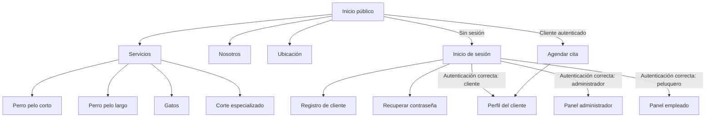
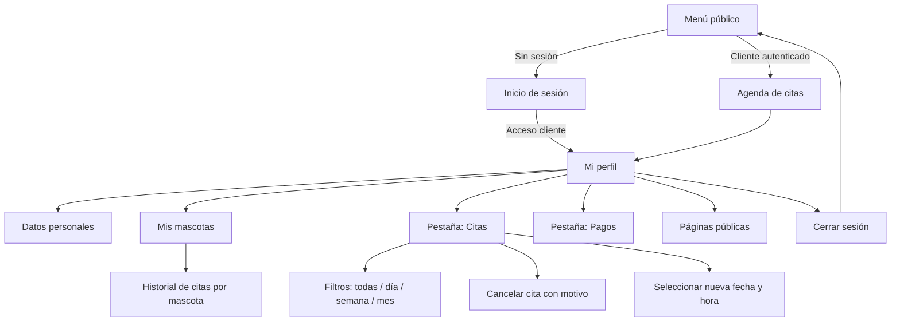
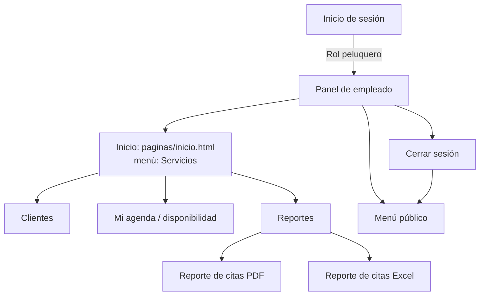
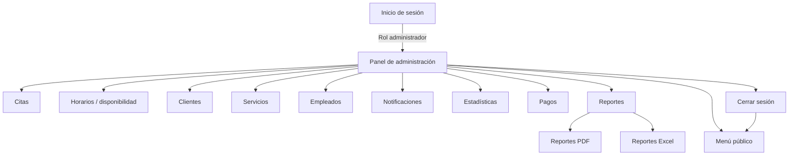

# Mapas de navegación por rol

Este documento describe los accesos y destinos de navegación visibles en el frontend de EDEA.PRO. Los diagramas reflejan las páginas HTML y los enlaces presentes actualmente en `public/edeapro`; no representan permisos de backend que no estén expuestos como enlaces.

## Sitio público y visitante

El visitante puede consultar las páginas informativas. La agenda requiere iniciar sesión como cliente: el menú conduce a login cuando no existe sesión y permite ir a la agenda si la sesión activa corresponde a un cliente.

## Cliente

El cliente llega a su perfil desde el enlace de sesión del sitio. El perfil está organizado en información personal, mascotas y las pestañas de citas y pagos. Desde la sección de citas puede consultar filtros y acciones disponibles para cancelar o reagendar; también puede volver a la agenda desde la navegación principal.

## Empleado / peluquero

El acceso público cambia a “Mi panel” cuando hay una sesión de peluquero. La página `inicio.html` funciona como destino inicial; la etiqueta del menú de esa página actualmente dice “Servicios”.

## Administrador

El administrador entra al panel desde el sitio público después de autenticarse. El panel `index.html` redirige a `paginas/inicio.html`, que concentra la navegación a los módulos de gestión.

## Rutas de entrada verificadas

| Área | Página inicial | Destinos principales |
|---|---|---|
| Sitio público | `public/edeapro/paginas/inicio.html` | Servicios, Nosotros, Ubicación, Agenda y login |
| Cliente | `public/edeapro/cliente/perfil.html` | Datos, mascotas, citas y pagos |
| Empleado | `public/edeapro/empleado/paginas/inicio.html` | Clientes, Mi agenda y Reportes |
| Administrador | `public/edeapro/administrador/paginas/inicio.html` | Citas, horarios, clientes, servicios, empleados, notificaciones, estadísticas, pagos y reportes |

## Notas de navegación

- El sitio público usa `localStorage` (`user` y `rol`) para cambiar los destinos de la navegación según la sesión.
- El enlace “Agendar cita” conduce al login si no hay sesión y a la agenda si la sesión es de cliente.
- Los diagramas documentan navegación visible. La autorización efectiva de cada endpoint se aplica por middleware en `routes/api.php`.
- La etiqueta “Servicios” del menú del empleado apunta a `paginas/inicio.html`; conviene revisar el texto si se desea que el menú describa mejor el contenido real de esa página.